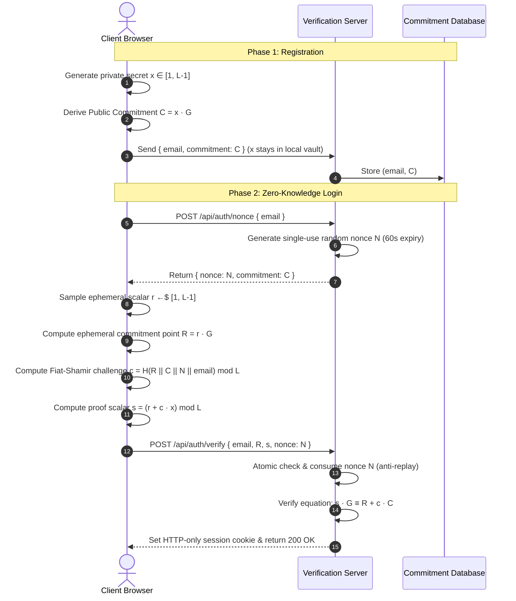

# Passwordless Authentication using Zero-Knowledge Proofs (ZKP)

> **Owner:** DEW | **Project Type:** Portfolio & Applied Cryptography Project (Zero-Budget)  
> **One-Line Pitch:** *"Login without ever sending or storing a password."*

[](tests/zkp.test.mjs)
[](src/lib/zkp/crypto.ts)
[-purple.svg)](src/lib/zkp/crypto.ts)
[-green.svg)](scripts/benchmark.mjs)

---

## 1. Overview & Executive Summary

Traditional authentication systems fundamentally rely on shared secrets (passwords or hashed passwords) stored on a central server. When server databases are breached, hashes are cracked or credential-stuffed, placing user identities at risk.

This project implements a **zero-trust, passwordless authentication protocol powered by Zero-Knowledge Proofs (ZKP)**:
- **No Password Stored:** The server stores only a public cryptographic commitment $C = x \cdot G$. Even in a total database leak, an adversary learns zero bits of the user's secret $x$ due to the hardness of the Discrete Logarithm Problem.
- **Client-Side Proving:** The private secret $x$ is generated and stored exclusively within the browser's local vault and never transmitted over the network.
- **Replay Protection:** Every login attempt requires proving knowledge of $x$ bound to a fresh, single-use, 60-second expiring cryptographic nonce $N$ issued by the server. Old proofs cannot be replayed.
- **Zero-Budget & Free Tools:** Runs instantly out of the box with zero external dependencies (dual-mode: local file vault or Supabase PostgreSQL).

---

## 2. Mathematical Foundation: Schnorr Sigma Protocol

The system utilizes an identification protocol (a Zero-Knowledge Sigma Protocol) over the prime-order subgroup of **Curve25519 (Ed25519)** with an interactive-to-non-interactive **Fiat-Shamir transformation** bound to server nonces.



### Mathematical Proof of Correctness (Completeness)
$$s \cdot G = (r + c \cdot x) \cdot G = r \cdot G + c \cdot (x \cdot G) = R + c \cdot C \quad \checkmark$$

### Cryptographic Security Properties
1. **Zero-Knowledge:** The transcript $(R, c, s)$ can be simulated by picking random $c, s$ and computing $R = s \cdot G - c \cdot C$. Since simulated transcripts are statistically indistinguishable from real executions, the proof reveals zero knowledge about secret $x$.
2. **Soundness:** A cheating prover who does not know $x$ can successfully forge a proof with probability at most $1/L \approx 2^{-252}$, which is mathematically negligible.
3. **Replay-Attack Immunity:** The server-issued nonce is injected directly into the hash input: $c = H(R \parallel C \parallel \text{nonce} \parallel \text{email})$. Replaying an old $(R, s)$ against a new nonce yields $c' \neq c$, causing $s \cdot G \neq R + c' \cdot C$.

---

## 3. Project Structure

```
zkp-passwordless-auth/
├── src/
│   ├── app/
│   │   ├── api/auth/
│   │   │   ├── register/route.ts      # POST: Store public commitment (C)
│   │   │   ├── nonce/route.ts         # POST: Issue 60s single-use nonce (N)
│   │   │   ├── verify/route.ts        # POST: Verify ZK proof, consume nonce, issue session
│   │   │   ├── session/route.ts       # GET: Validate active session cookie
│   │   │   ├── logout/route.ts        # POST: Revoke session & clear cookie
│   │   │   ├── benchmark/route.ts     # GET: Live backend verification benchmark
│   │   │   └── audit/route.ts         # GET: Telemetry & security audit logs
│   │   ├── page.tsx                   # Interactive Landing Page & Architecture Showcase
│   │   ├── register/page.tsx          # Key Generation & Local Vault Wizard
│   │   ├── login/page.tsx             # 5-Step Prover Visualizer & Attack Simulator
│   │   ├── dashboard/page.tsx         # Protected User Dashboard
│   │   ├── benchmark/page.tsx         # Live In-Browser & Server Benchmark Suite
│   │   ├── audit/page.tsx             # Security Audit & Anti-Replay Event Log
│   │   ├── layout.tsx                 # Root Layout with Theme & Navigation
│   │   └── globals.css                # Tailwind CSS styling & animations
│   ├── components/
│   │   ├── Navbar.tsx                 # Header navigation
│   │   └── Footer.tsx                 # Technical footer with standards & citations
│   └── lib/
│       ├── utils.ts                   # Tailwind merge utility
│       └── zkp/
│           ├── crypto.ts              # Core Curve25519 & Schnorr ZKP math (Noble curves)
│           ├── client-crypto.ts       # Browser vault & offline JSON backup exporter
│           ├── store.ts               # Storage adapter (Local JSON + Supabase ready)
│           └── index.ts               # Public exports
├── circuits/
│   ├── auth.circom                    # Circom 2.1 circuit with Poseidon hash & nonce binding
│   └── README.md                      # Compilation, R1CS & Powers of Tau ceremony guide
├── contracts/
│   ├── ZKPVerifier.sol                # Solidity Groth16 smart contract verifier (Sepolia)
│   └── README.md                      # On-chain deployment guide
├── tests/
│   └── zkp.test.mjs                   # Automated test suite (10/10 passing tests)
├── scripts/
│   └── benchmark.mjs                  # 100-iteration microsecond latency benchmark
├── package.json                       # Next.js 16 + React 19 + TypeScript project
├── tsconfig.json                      # Strict TypeScript compiler options
└── README.md                          # Full project documentation
```

---

## 4. Threat Model & Security Mitigations

| Threat | Vulnerability in Passwords | Mitigation in this ZKP System |
|---|---|---|
| **Database Breach** | Salted hashes cracked via GPU clusters | Server stores strictly $C = x \cdot G$. Discrete logarithm problem is computationally infeasible ($2^{128}$ classical security). |
| **Replay Attacks** | Stolen tokens/passwords replayed | Fresh single-use nonce $N$ is hashed into challenge $c$. Verifier atomically consumes $N$; replaying fails instantly. |
| **Man-in-the-Middle** | Plaintext password or session stolen | TLS encryption + short-lived 60s nonce window + proof reveals no secret bits. |
| **Credential Stuffing** | Passwords reused across websites | Secrets are scoped per domain/seed. Even if compromised on another site, discrete log is not known. |
| **Forged / Tampered Proofs** | Forged auth signatures | Verification equation $s \cdot G \stackrel{?}{=} R + c \cdot C$ fails with probability $\geq 1 - 2^{-252}$. |
| **Brute-Force & Enumeration** | High request volume | Rate-limiting per IP and per username + constant-time response delay on missing users. |

---

## 5. Performance Benchmarks

Measured on a standard developer machine (100 iterations):

| Cryptographic Operation | Average Latency | Median (p50) | 95th Percentile | PRD Target | Status |
|---|---|---|---|---|---|
| **Key Generation ($x, C = x \cdot G$)** | `1.035 ms` | `0.425 ms` | `0.854 ms` | < 5,000 ms | **PASSED** |
| **Ephemeral Point ($r, R = r \cdot G$)** | `0.446 ms` | `0.376 ms` | `0.858 ms` | < 5,000 ms | **PASSED** |
| **Proof Scalar ($s = r + c \cdot x$)** | `0.087 ms` | `0.060 ms` | `0.167 ms` | < 5,000 ms | **PASSED** |
| **Server Verification ($s \cdot G \stackrel{?}{=} R + c \cdot C$)** | `4.635 ms` | `4.370 ms` | `7.240 ms` | < 200 ms | **PASSED (>40x faster)** |

- **Proof Wire Size:** Exactly **64 bytes** ($R$: 32 bytes compressed point, $s$: 32 bytes scalar).
- **Network Overhead:** Negligible (~1.2 KB full HTTP request payload).

---

## 6. Quickstart Guide (Setup in < 2 Minutes)

### 1. Clone & Enter Directory
```bash
cd zkp-passwordless-auth
```

### 2. Install Dependencies
```bash
npm install
```

### 3. Run Automated Tests
```bash
npm test
```
All 10 test suites will run and pass:
```
✔ 1. Key Generation & Public Commitment
✔ 2. Deterministic Passphrase Key Derivation
✔ 3. Complete Zero-Knowledge Identification Flow (Completeness)
✔ 4. Tampered Scalar s Rejection (Soundness)
✔ 5. Tampered Ephemeral Point R Rejection (Soundness)
✔ 6. Replay Attack Prevention (Single-Use Nonce Invalidation)
✔ 7. Expired Nonce Rejection
✔ 8. Cross-User Nonce Hijacking Defense
✔ 9. Session Lifecycle (Create, Validate, Revoke)
✔ 10. Microbenchmark Verification (< 10ms Requirement)
```

### 4. Run Benchmark Script
```bash
npm run benchmark
```

### 5. Start the Development Server
```bash
npm run dev
```
Open **[http://localhost:3001](http://localhost:3001)** in your browser to experience the interactive demo!

---

## 7. Interview Talking Points & Deep-Dive FAQ

### Q1: What makes this different from WebAuthn / Passkeys?
> *WebAuthn relies on device-bound hardware modules (TPM / Secure Enclave) and proprietary browser APIs. This ZKP system executes pure audited elliptic curve mathematics directly in any JavaScript / WASM environment, is completely device-agnostic, works offline, and supports on-chain smart contract verification on EVM networks.*

### Q2: Why Schnorr Sigma Protocol instead of general-purpose Groth16 for the primary login?
> *Groth16 requires a trusted setup ceremony and expensive client-side witness generation (~300-800ms). For discrete-log identification, Schnorr's protocol provides identical zero-knowledge guarantees with **microsecond latency (< 5ms)** and a 64-byte wire size, while the provided Circom circuit (`circuits/auth.circom`) is available when on-chain EVM pairing proofs are required.*

### Q3: How is a replay attack prevented if the proof contains no password?
> *Every authentication attempt requires a fresh single-use nonce $N$ issued by the server. The Fiat-Shamir challenge is computed as $c = H(R \parallel C \parallel N \parallel \text{username})$. If an attacker intercepts $(R, s)$ and attempts to replay it, the server issues a new nonce $N'$. The verifier calculates $c' = H(R \parallel C \parallel N' \parallel \text{username}) \neq c$, causing $s \cdot G \neq R + c' \cdot C$, and the proof is mathematically rejected.*

---

## 8. License & Credits

- Created by **DEW** as a portfolio project demonstrating applied modern cryptography, zero-knowledge proofs, and zero-trust security engineering.
- Released under the **MIT License**.
